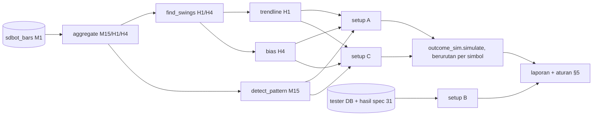

# Design — Lab setup trendline H1 + PA M15

Status: Done (2026-10-13)
Requirements: [requirements.md](requirements.md) (Approved 2026-10-13)

## 1. Overview

Satu alat Python `tools/trendline_lab.py`, tanpa perubahan EA:

1. **Data.** Bar M1 dari `ExportBars` (spec 31) diagregasi ke M15, H1, dan H4. Bar M1 untuk exit disimulasikan `outcome_sim.simulate`.
2. **Port aturan EA (murni, teruji):**
   - `find_swings` (fractal berjeda, `StructureRules.FindSwings`);
   - `structure_dir` dan `ema_dir` → `bias` (`StructureOf`, `EmaDirectionOf`, mode AND_EMA, EMA bias 21, EMA slope 3);
   - `trendline` (`TlEvaluate`: kemiringan ≥ 0,02 ATR/bar, sentuhan ≤ 0,2 ATR, patah, pemilihan terbaik);
   - `detect_pattern` (`PatternRules.DetectPattern` dengan konstanta `SDB_PA_*` dan ATR(14) M15).
3. **Setup** A dan C dievaluasi di setiap bar M15 tertutup memakai H1/H4 yang sudah tutup (tanpa lookahead). Hasilnya kandidat `outcome_sim.Candidate`:
   - `zone_dist` = titik jangkar SL (ekstrem bar pola, atau garis untuk A bila lebih jauh), sehingga `build_stops` memberi SL = jangkar ∓ 0,1 ATR H1 (SELL + spread);
   - `opp_prox` = `None` → TP 2R;
   - `bid` = close bar, `ask` = bid + spread bar.
4. **Simulasi berurutan per simbol:** setup selama posisi simbol masih terbuka dilewati (Req 2.6).
5. **Setup B** dibaca dari DB dan CSV simulasi spec 31 (kandidat dengan `tl_touches` ≥ 2), tanpa simulasi baru.
6. **Laporan** per setup × varian bias × periode, ditambah per simbol. Aturan pilih §5.

## 2. Arsitektur

## 3. Komponen dan antarmuka

| Fungsi | Port dari | Murni | Kriteria |
|---|---|---|---|
| `aggregate(bars, tf_sec) -> Bars` | — | ya | 1.2 |
| `atr_series(bars, 14) -> np.ndarray` | iATR (SMA TR) | ya | 1.1 |
| `find_swings(h, l, strength) -> list[Swing]` | `FindSwings` / `IsSwingHigh/Low` | ya | 1.1 |
| `structure_dir(...)`, `ema_dir(...)`, `bias(...)` | `StructureOf`, `EmaSeries`, `EmaDirectionOf`, `BiasOf` | ya | 1.1 |
| `trendline(bars_h1, end, buy, atr) -> Line \| None` | `TlEvaluate` (varian tanpa zona: jarak ke harga) | ya | 1.1, EC-01 |
| `tl_vs_zone(...)` | `TlEvaluate` dengan zona (untuk verifikasi Req 1.3) | ya | 1.3 |
| `detect_pattern(bars_m15, i, atr, dir) -> str` | `DetectPattern` + `Is*` | ya | 1.1 |
| `setups_a(...)`, `setups_c(...) -> list[Candidate]` | — | ya | 2.1–2.4 |
| `run_symbol(sym, period, variant) -> list[Outcome]` | — | — | 2.5, 2.6 |
| `verify(db, run) -> VerifyReport` | — | — | 1.3 |
| CLI: `run --bars --db --period IS=A-B ...`, `verify --db --runs ...` | — | — | 4 |

**Tanpa lookahead (Req 1.2).** Pada bar M15 berawal t (dinilai saat tutup, t + 900), H1 dan H4 yang dipakai adalah bar yang **tutup ≤ t + 900**, sama dengan EA yang menilai di bar M15 baru. Uji khusus (TS) memotong data sesudah t dan memastikan hasil identik.

**Pemetaan periode.** IS/OOS/REAL = rentang tanggal dari `periods.ini` (bukan sesi DB), dengan pemanasan histori 60 hari sebelum awal periode.

## 4. Error handling

- Simbol tanpa CSV bar: dilewati dan dicatat.
- Hasil verifikasi (Req 1.3) di bawah ambang: laporan tetap dibuat dengan header **VERIFIKASI GAGAL** dan tidak dipakai untuk keputusan sampai selisihnya dijelaskan atau diperbaiki.

## 5. Aturan verifikasi dan pilih (ditulis sebelum hasil)

**Verifikasi port** (pada kandidat EA acuan IS 1968–1979, sampel semua kandidat yang punya data):
- pola PA lab = `pa` di `context_json` untuk ≥ 95% kandidat;
- arah bias lab = arah kandidat untuk ≥ 95%;
- `tl_touches` lab = EA untuk ≥ 90% kandidat yang punya trendline, dan selisih `tl_dist` ≤ 0,02 ATR.

**Pilih:**
1. Varian (setup × bias) lolos IS bila:
   - ≥ 100 trade;
   - R per trade ≥ +0,10;
   - PF ≥ 1,20.
2. Varian lolos IS dikonfirmasi sekali di OOS dan REAL: R per trade ≥ +0,05 dan total R > 0 di keduanya.
3. Varian yang lolos konfirmasi dicatat sebagai kandidat spec EA, dengan tambahan trade per bulan.

## 6. Test case

| ID | Kasus | Harapan | Kriteria |
|---|---|---|---|
| TS-116 | `aggregate` M1 → M15/H1: OHLC dan waktu awal bar | sesuai hitungan tangan | 1.2 |
| TS-117 | `find_swings` pada deret dari `TestStructure` (TC-MS-01..05) | indeks dan harga swing sama | 1.1 |
| TS-118 | `detect_pattern` pada fixture `TestPatterns` (bintang, engulfing kuat, pin, engulfing, tweezer, outside, netral) | kode pola sama dengan uji MQL5 | 1.1 |
| TS-119 | `trendline`: tiga swing low naik → garis 3 sentuhan; kemiringan < 0,02 ATR → tidak ada; close menembus > 0,2 ATR → patah | sesuai | 1.1, EC-01, EC-02 |
| TS-120 | `bias`: struktur BULL + EMA naik → BULL; konflik → NONE | sesuai `BiasOf` AND_EMA | 1.1 |
| TS-121 | Setup A pada bar sintetis: sentuh support + pin bullish → 1 kandidat BUY, SL dan TP benar; tanpa pola → 0 | sesuai | 2.1 |
| TS-122 | Setup C: tembus > 0,2 ATR, retest di bar ke-5 dengan engulfing searah → 1 kandidat; retest di bar ke-21 → 0 | sesuai | 2.2 |
| TS-123 | Tanpa lookahead: hasil setup di bar t sama sebelum dan sesudah data setelah t dibuang | identik | 1.2 |
| TS-124 | Berurutan per simbol: setup kedua saat posisi pertama terbuka dilewati | 1 trade | 2.6, EC-04 |
| RUN-01 | `verify` pada IS acuan | ambang §5 | 1.3 |
| RUN-02 | `run` IS untuk A/C × bias/tanpa bias; laporan + setup B | aturan §5 | 2, 3, 4.1, 4.2 |
| RUN-03 | Varian lolos: OOS + REAL | aturan §5.2 | 4.3, 4.4 |

## 7. Traceability

| Req | Komponen | Uji |
|---|---|---|
| 1.1 | port aturan | TS-117..120 |
| 1.2 | `aggregate`, urutan bar | TS-116, TS-123 |
| 1.3 | `verify` | RUN-01 |
| 2.1–2.6 | setup A/C, simulasi berurutan | TS-121, TS-122, TS-124 |
| 3.1 | setup B dari data spec 31 | RUN-02 |
| 4.1–4.5 | laporan, aturan §5 | RUN-02, RUN-03 |

## 8. Keputusan yang perlu disetujui

1. **Lab Python dengan port aturan EA dan verifikasi terhadap data EA** (§5), bukan menjalankan setup di Strategy Tester. Jauh lebih cepat untuk tiga setup × dua varian; risiko perbedaan port ditutup lewat verifikasi.
2. **Jangkar SL lewat `zone_dist`** agar simulator spec 31 dipakai tanpa perubahan.
3. **Periode dari tanggal** (`periods.ini`) dengan pemanasan 60 hari.
4. **Ambang verifikasi port** (95% / 95% / 90%).
