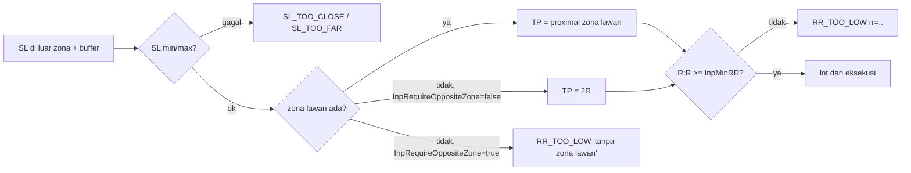

# Design — Entry hanya dengan TP ke zona lawan (H6)

Status: Done (2026-10-12)
Requirements: [requirements.md](requirements.md) (Approved 2026-10-12)

## 1. Overview

- **Aturan murni.** `BuildStops` (`Signals/SignalRules.mqh`) mendapat satu cabang. Bila `p.requireOppositeZone` dan `!f.haveOpposite`, hasilnya `RR_TOO_LOW` dengan detail `tanpa zona lawan`. Cabang ini dicek sesudah SL min/max, di posisi yang sama dengan pemilihan TP sekarang, jadi urutan tahap PRD tidak berubah. Bila zona lawan ada, jalurnya sama persis dengan sekarang.
- **Input.** `InpRequireOppositeZone` (bool, default `false`) mengalir lewat `InputValues` → `SdbSignalParams.requireOppositeZone` di `CSdbApp`. Kunci ke-57 di `inputs_json`.
- **Telemetri.** Kandidat yang ditolak tetap punya `entry`/`sl` di `context_json` (stops sudah dihitung), sedangkan `tp`, `rr`, `tp_source` = `null`. Ini sama dengan kandidat yang gagal di tahap SL.
- **Pengukuran.** `-SetInput 'InpRequireOppositeZone=true'` di IS, aturan pilih §5, lalu OOS + REAL. Default berubah hanya bila diterima.

## 2. Alur tahap SL/TP

## 3. Komponen

| Komponen | Perubahan | Murni | Kriteria |
|---|---|---|---|
| `Core/Types.mqh` | `SdbSignalParams.requireOppositeZone` (bool) | — | 1.1 |
| `Core/Constants.mqh` | `SDB_DEF_REQUIRE_OPPOSITE_ZONE false` | — | 1.1 |
| `Core/InputRules.mqh` | `InputValues.requireOppositeZone` + default | — | 1.1 |
| `Core/Inputs.mqh` | `input bool InpRequireOppositeZone`; `inputs_json` kunci ke-57 | — | 1.1, 1.5 |
| `Signals/SignalRules.mqh` | `BuildStops`: cabang tanpa zona lawan saat wajib → `SgReject(..., SDB_REJECT_STAGE_RR_TOO_LOW, "tanpa zona lawan")` | ya | 1.2–1.4 |
| `App/SdbApp.mqh` | `sp.requireOppositeZone = cfg.inputs.requireOppositeZone` | — | 1.1 |
| Uji: `TestSignalRules.mqh` (`SgP0` + kasus), `TestSignalEngine.mqh`, `TestCodec.mqh` (57), `TestPresets.mqh` (kunci dikenal) | — | — | 1.1–1.5 |
| `tools/gen_presets.py` + 12 preset | `InpRequireOppositeZone=false` (sementara) | — | 1.1, 3.3 |
| README (tabel konfigurasi), `docs/flows/signals.md` (node TP) | baris input dan cabang | — | 1.1 |
| Versi | 1.30; 1.31 bila diterima | — | 3.3, 3.4 |

Manajemen posisi tidak membaca input ini, jadi Req 1.6 terpenuhi tanpa perubahan.

## 4. Error handling

Tidak ada kondisi gagal baru. Input bool tidak perlu validasi rentang. `make_local_presets.py` menyalin kunci baru dari preset repo secara otomatis.

## 5. Aturan pilih (ditulis sebelum OOS)

1. IS lolos bila:
   - R per trade IS > +0,079 (acuan 1.28, sesi 1848–1859);
   - IS ≥ 100 trade;
   - setiap simbol ≥ 5 trade (keputusan 1).
2. Bila lolos: OOS dan REAL sekali.
3. DITERIMA bila:
   - R per trade OOS ≥ +0,163;
   - R per trade REAL ≥ +0,080;
   - total R REAL ≥ +10,1R.
4. Selain itu DITOLAK (Req 2.4, 3.4).

## 6. Test case

| ID | Kasus | Harapan | Kriteria |
|---|---|---|---|
| TC-SG-41 | F0 tanpa zona lawan, `requireOppositeZone=true` | `RR_TOO_LOW`, detail `tanpa zona lawan`, `stopsKnown`, `tp_source` kosong | 1.2, EC-02 |
| TC-SG-42 | F0 dengan zona lawan 1.10350, `true` | lolos, TP 1.10350, R:R 2,60 (sama dengan TC-SG-21) | 1.3 |
| TC-SG-43 | F0 tanpa zona lawan, `false` | lolos, TP 2R (sama dengan sekarang); zona lawan R:R < 2 dengan `true` → `RR_TOO_LOW rr=..` | 1.4, EC-01, EC-03 |
| TC-SU-04c, TestPresets, TS-113 | 57 kunci; preset `InpRequireOppositeZone=false` | sesuai | 1.5, 1.1 |
| REG | `-All` dengan default | semua PASS (perilaku identik) | 1.4 |
| RUN-01 | `-Period IS -SetInput 'InpRequireOppositeZone=true'` | `baseline_report`, `exit_report`, `trade_diff` vs 1848–1859; aturan §5 | 2.1–2.4 |
| RUN-02 | Bila lolos: `-Period OOS`, `REAL` | vs 1860–1871, 1872–1883 | 3.1, 3.2 |

Tidak ada skenario harness baru: perilakunya hanya cabang di fungsi murni yang sudah diuji, dan RUN-01 membuktikan jalur EA ujung ke ujung (tidak ada trade `tp_source = RR`).

## 7. Traceability

| Req | Komponen | Uji |
|---|---|---|
| 1.1, 1.5 | Types, Constants, InputRules, Inputs, SdbApp, preset | TC-SU-04c, TestPresets, TS-113 |
| 1.2–1.4 | `BuildStops` | TC-SG-41..43, REG |
| 1.6 | manajemen posisi (tidak berubah) | REG |
| 2.1–2.4 | runner, laporan, aturan §5 | RUN-01 |
| 3.1–3.5 | runner, default, preset, PC | RUN-02, REG |

## 8. Keputusan yang perlu disetujui

1. **Cabang ditempatkan sesudah cek SL min/max**, di titik pemilihan TP. Kandidat yang SL-nya tidak sah tetap tercatat `SL_TOO_*` seperti sekarang.
2. **RUN-01 tanpa skenario harness baru** (§6).
3. **Aturan pilih §5**, termasuk syarat total R REAL.
4. **Versi 1.30 untuk input, 1.31 bila diterima.**
