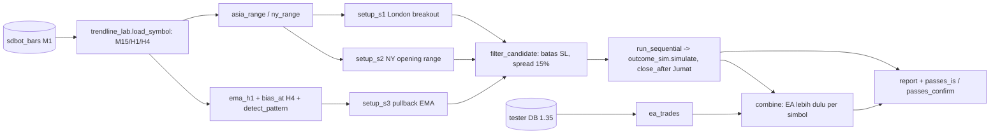

# Design — Lab strategi kedua untuk frekuensi (H11)

Status: Done (2026-10-15)
Requirements: [requirements.md](requirements.md) (Approved 2026-10-14)

## 1. Overview

Satu alat Python baru, `tools/strategy_lab.py`, tanpa perubahan EA. Alat ini memakai ulang yang sudah terverifikasi:
- **`trendline_lab.py` (spec 32):** agregasi M1 → M15/H1/H4 (`aggregate`, `closed_count`), ATR Wilder EA (`wilder_atr`), bias H4 (`bias_at`), pola PA (`detect_pattern`), muat simbol (`load_symbol`), statistik (`summarize`), periode (`_periods`). Port ini sudah diverifikasi 99,7–100% terhadap kandidat EA.
- **`outcome_sim.py` (spec 31):**
  - `Candidate` dan `simulate` untuk exit, dengan BE dan partial dimatikan (`be_r = partial_r = 99`), sehingga hanya SL dan TP tetap (`opp_prox = None` → TP = `min_rr × R`);
  - satu parameter opsional baru `close_after` untuk penutupan Jumat (Req 5.4). Perilaku lama tetap bila parameter tidak diisi.

Alur per simbol × setup × varian TP:
1. Setup menghasilkan kandidat dengan jangkar SL di `zone_dist`.
2. Kandidat disaring: batas SL (`build_stops.passes_rules`) dan spread ≤ 15% R.
3. Kandidat disimulasikan berurutan (satu posisi per simbol per setup).
4. Laporan disusun, lalu aturan lolos dari requirements diterapkan.

Simulasi gabungan memakai trade EA 1.35 dari tester DB.

**Zona waktu:** jam server Broker B = UTC (diperiksa 2026-10-14: selisih −3 detik; pembukaan Minggu 21:00 UTC musim panas, 22:00 musim dingin). Bar ekspor bertanggal server, jadi tidak perlu konversi (Req 1.2). Uji TS-137 mengunci asumsi ini pada data.

## 2. Arsitektur

## 3. Komponen dan antarmuka

| Fungsi | Murni | Keterangan | Req |
|---|---|---|---|
| `session_range(m1, day_start, start_sec, end_sec, max_gap_sec=1800) -> Range \| None` | ya | high/low bar M1 dalam [awal, akhir); `None` bila tidak ada bar atau ada celah > 30 menit | 2.1, 3.1, EC-02 |
| `breakout_signal(m15, rng, win_from, win_to, atr_h1_of, min_w, max_w) -> Signal \| None` | ya | tembusan pertama close M15 > high + 0,1 ATR H1 (BUY) atau < low − 0,1 ATR (SELL) dalam jendela; `None` bila lebar range di luar [min_w, max_w] × ATR | 2.1–2.3, 3.1–3.3, EC-03 |
| `setup_s1(d, day) -> Signal \| None` | ya | range 00:00–07:00, jendela 07:00–11:00, lebar 0,5–2,5 ATR | 2 |
| `setup_s2(d, day) -> Signal \| None` | ya | range 13:30–14:00, jendela 14:00–17:00, lebar 0,3–2 ATR | 3 |
| `ema_series(close, period=21) -> np.ndarray` | ya | EMA seperti `EmaSeries` EA (benih SMA) | 4.1 |
| `setup_s3_at(d, j) -> Signal \| None` | ya | bar M15 ke-j: bias H4 ≠ 0, low/high dalam 0,2 ATR H1 dari EMA 21 H1 (bar H1 tutup), pola PA searah bias, sesi London/NY ≤ 22:00 | 4.1–4.3 |
| `to_candidate(sig, d) -> osim.Candidate` | ya | `zone_dist` = jangkar SL (sisi lain range, atau ekstrem bar pola); `atr_mtf` = ATR H1; `opp_prox = None`; bid = close bar sinyal, ask = bid + spread bar | 1.4, 2.2, 3.2, 4.2 |
| `filter_candidate(c, rules) -> str \| None` | ya | alasan lewat: `SL_RANGE` (di luar 0,3–3 ATR) atau `SPREAD` (> 15% R); `None` bila lolos | 5.2, 5.3, EC-07 |
| `friday_close(t, crypto) -> int \| None` | ya | 21:45 UTC Jumat minggu yang sama; `None` untuk BTC | 5.4, EC-05 |
| `osim.simulate(..., close_after=None)` | ya | tambahan: bar M1 dengan waktu ≥ `close_after` → keluar di open bar itu, alasan `FRIDAY` | 5.4 |
| `run_sequential(cands, sim) -> list[Trade]` | ya | kandidat yang muncul sebelum posisi sebelumnya tutup dilewati (`trendline_lab.sequential`) | 5.5 |
| `combine(ea, lab) -> list[Trade]` | ya | per simbol: trade lab yang tumpang tindih dengan posisi EA (buka–tutup) dilewati; EA selalu dipertahankan | 6.4, EC-08 |
| `passes_is(s, per_symbol) -> bool` | ya | ≥ 120 trade, R ≥ +0,10, PF ≥ 1,20, ≥ 7 dari 12 simbol total R > 0 | 6.2 |
| `passes_confirm(s) -> bool` | ya | R ≥ +0,05 dan total R > 0 | 6.3 |
| `ea_trades(db, ranges) -> list[Trade]` | tidak (DB `mode=ro`) | trade EA 1.35: simbol, buka, tutup, R | 6.4 |
| CLI `run --bars --periods --period IS --setups S1,S2,S3 --rr 1.5,2 [--out]` | — | laporan Req 6.1 | 6.1 |
| CLI `confirm --setup S2 --rr 2 --periods OOS,REAL` | — | konfirmasi varian terpilih | 6.3 |
| CLI `combine --db --setup S2 --rr 2 --ea IS=2307-2318,OOS=2376-2387,REAL=2388-2399` | — | laporan gabungan | 6.4, 6.5 |

`Signal` = `(setup, symbol, time_bar_m15, direction, sl_anchor, pattern)`. Entry di open bar M15 berikutnya sama dengan simulator: bar M1 mulai sesudah bar kandidat tutup.

## 4. Data models

- Tidak ada perubahan DB atau EA.
- `outcome_sim.Outcome.reason` mendapat nilai baru `FRIDAY`.
- Aturan exit lab: `ExitRules(sl_buffer_atr=0.1, min_rr=1.5 | 2.0, min_sl_atr=0.3, max_sl_atr=3.0, be_r=99, be_buffer_pts=2, partial_r=99, partial_pct=50, trail_atr_period=14, trail_atr_mult=2)`. Trailing tidak pernah aktif karena hanya berjalan sesudah BE.
- Konstanta di atas modul (tanpa angka di dalam fungsi): jam jendela, batas lebar range, toleransi 0,1 / 0,2 ATR, spread 15%, ambang lolos.
- Laporan: tabel teks; opsi `--out` menulis CSV trade (setup, simbol, waktu, arah, R, alasan, lama).

## 5. Error handling

| Kondisi | Perilaku |
|---|---|
| CSV bar simbol tidak ada | simbol dilewati, dicatat di header laporan |
| Data tidak menutup periode (bar M1 sampai 2026-10-01) | periode dipotong di bar terakhir, dicatat |
| Hari tanpa range (libur, celah) | dilewati, dihitung per setup (EC-02) |
| Simulasi tanpa bar sesudah entry | `open_at_end`, tidak dihitung, jumlahnya dicatat |
| `ea_trades` tidak menemukan sesi | error jelas, exit 2 |

## 6. Test case

| ID | Kasus | Harapan | Req |
|---|---|---|---|
| TS-137 | Bar ekspor EURUSDc: bar H1 pertama setiap minggu jatuh pada 21:00 atau 22:00 UTC Minggu | asumsi server = UTC terkunci | 1.2, EC-01 |
| TS-138 | `session_range`: bar sintetis 00:00–07:00 → high/low benar; celah 31 menit → `None`; tanpa bar → `None` | sesuai | 2.1, EC-02 |
| TS-139 | `breakout_signal` S1: close 07:15 = high + 0,15 ATR → BUY; + 0,05 ATR → tidak; tembus atas lalu bawah → hanya yang pertama; tembus 11:15 → tidak; lebar 0,4 / 2,6 ATR → `None` | sesuai | 2.1–2.3, EC-03 |
| TS-140 | `setup_s2`: range 13:30–14:00, tembus 13:45 (sebelum jendela) → tidak; 14:15 → ya; lebar 0,25 ATR → `None` | sesuai | 3.1–3.3 |
| TS-141 | `setup_s3_at`: bias BULL + low dalam 0,15 ATR dari EMA + pin bullish → BUY; 0,25 ATR → tidak; pola netral → tidak; bias 0 → tidak; jam 23:00 → tidak | sesuai | 4.1–4.3 |
| TS-142 | Tanpa lookahead: hasil setup di bar t identik sebelum dan sesudah data setelah t dibuang (ketiga setup) | identik | 1.3 |
| TS-143 | `to_candidate` + `osim.build_stops`: SELL S1 dengan high range 1,10500, ATR 0,0010, spread 2 point → SL = 1,10500 + 0,0001 + spread; TP = entry − 2R | angka tepat | 1.4, 2.2 |
| TS-144 | `filter_candidate`: SL 0,25 ATR → `SL_RANGE`; spread 16% R → `SPREAD`; 15% tepat → lolos | sesuai | 5.2, 5.3, EC-07 |
| TS-145 | `simulate` dengan `close_after`: posisi masih terbuka Jumat 21:45 → `FRIDAY` di open bar; tanpa parameter → hasil sama dengan sebelumnya (fixture kalibrasi spec 31) | sesuai | 5.4 |
| TS-146 | `friday_close` BTC → `None`; EURUSD Rabu → Jumat 21:45 minggu yang sama | sesuai | 5.4, EC-05 |
| TS-147 | `run_sequential` + `combine`: setup kedua saat posisi pertama terbuka dilewati; trade lab yang tumpang tindih dengan trade EA dilewati, EA tetap | sesuai | 5.5, 6.4, EC-08 |
| TS-148 | `passes_is` / `passes_confirm`: batas tepat (120 trade, +0,10, 1,20, 7 simbol) lolos; 119 / +0,099 / 6 simbol gagal | sesuai | 6.2, 6.3 |
| TS-149 | CLI `run` pada fixture 2 simbol sintetis | tabel memuat kolom Req 6.1 dan baris per simbol | 6.1 |
| RUN-01 | `run --period IS` tiga setup × dua TP | laporan + pilihan per setup | 6.1, 6.2 |
| RUN-02 | `confirm` varian terpilih OOS + REAL | aturan 6.3 | 6.3 |
| RUN-03 | `combine` untuk setup yang lolos | aturan 6.5 | 6.4, 6.5 |

## 7. Traceability

| Req | Komponen | Uji |
|---|---|---|
| 1.1 | `load_symbol` (spec 32) | TS-142 |
| 1.2 | server = UTC | TS-137 |
| 1.3 | jendela bar tertutup | TS-142 |
| 1.4 | `to_candidate`, `simulate` | TS-143 |
| 2.1–2.3 | `session_range`, `breakout_signal`, `setup_s1` | TS-138, TS-139 |
| 3.1–3.3 | `setup_s2` | TS-140 |
| 4.1–4.3 | `ema_series`, `setup_s3_at` | TS-141 |
| 5.1 | `ExitRules` lab | TS-143 |
| 5.2, 5.3 | `filter_candidate` | TS-144 |
| 5.4 | `friday_close`, `simulate(close_after)` | TS-145, TS-146 |
| 5.5 | `run_sequential` | TS-147 |
| 6.1–6.6 | laporan, `passes_*`, `combine` | TS-147..149, RUN-01..03 |

## 8. Keputusan yang perlu disetujui

1. **Simulator spec 31 dipakai dengan BE/partial dimatikan (99R)**, ditambah parameter opsional `close_after`. Alternatifnya simulator SL/TP baru, tetapi itu kehilangan kalibrasi 98–99% (urutan SL/TP dalam bar M1, spread).
2. **Jam server = UTC tanpa konversi**, diverifikasi di data (TS-137). Kalau broker berubah, uji ini gagal lebih dulu.
3. **Jangkar SL lewat `zone_dist`** seperti spec 32, sehingga buffer 0,1 ATR dan spread SELL ditangani `build_stops` yang sudah terkalibrasi.
4. **Simulasi gabungan memprioritaskan EA**: trade lab yang tumpang tindih dibuang. Ini meniru "maks 1 posisi per simbol" di live tanpa mengubah hasil S&D.
5. **Periode dari `periods.ini`**, dengan pemanasan 60 hari (EMA H1, bias H4).
