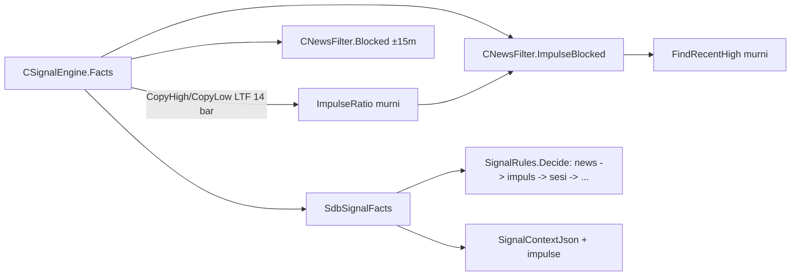

# Design — Filter candle impuls sesudah berita (H13)

Status: Done (2026-10-15)
Requirements: [requirements.md](requirements.md) (Approved 2026-10-14)

## 1. Overview

Filter impuls dibangun di atas filter berita yang ada (spec 16):
- **Kalender:** `CNewsFilter` sudah memuat event kalender (live: 1 hari ke belakang sampai 2 hari ke depan; tester: CSV), jadi berita yang rilis dalam 90 menit terakhir sudah tersedia tanpa sumber baru.
- **Rasio impuls:** dihitung `CSignalEngine` dari 14 bar LTF tertutup lewat fungsi murni `ImpulseRatio`, sama dengan definisi analisis H12.
- **Keputusan:** `CNewsFilter.ImpulseBlocked` mencari berita HIGH relevan terbaru dalam jendela, lalu membandingkan rasio dengan ambang.
- **Penolakan:** `SignalRules` menolak dengan tahap `NEWS_BLACKOUT` yang sudah ada, tepat sesudah cek blackout ±15 menit, sehingga skema DB tidak berubah.
- **Telemetri:** setiap kandidat mencatat `impulse` di `context_json`.

## 2. Arsitektur

Lapisan tetap: Filters (aturan murni + kelas kalender), Signals (pipeline), Core (input, tipe). Tidak ada perubahan Risk/Execution/Storage.

## 3. Komponen dan antarmuka

| Komponen | Lapisan | Antarmuka | Murni | Req |
|---|---|---|---|---|
| `ImpulseRatio` (NewsRules.mqh) | Filters | `double ImpulseRatio(const double &high[], const double &low[], const int n)`: indeks 0 = bar tertutup terbaru; butuh n ≥ 14; hasil = max range 8 bar terbaru / rata-rata range 14 bar terbaru; `SDB_NULL_DOUBLE` bila n < 14 atau rata-rata ≤ 0 | ya | 1.1, EC-03, EC-04 |
| `FindRecentHigh` (NewsRules.mqh) | Filters | `int FindRecentHigh(const SdbNewsEvent &ev[], const datetime bar, const string base, const string quote, const int minutes)`: event HIGH relevan dengan `0 ≤ bar − time ≤ minutes×60`, paling baru; −1 bila tidak ada | ya | 1.1, 1.5, EC-01, EC-05, EC-07 |
| `ImpulseDecision` (NewsRules.mqh) | Filters | `bool ImpulseDecision(const SdbNewsEvent &ev[], const datetime bar, const string base, const string quote, const SdbNewsParams &p, const double ratio, string &detail)`: true bila filter aktif, rasio valid ≥ `p.impulseMult`, dan `FindRecentHigh` ≥ 0; detail `"impuls x%.2f sesudah <event> <ccy> HIGH <m>m"` | ya | 1.1–1.3, 1.5, 2.2, EC-02 |
| `CNewsFilter.ImpulseBlocked` | Filters | `bool ImpulseBlocked(const datetime bar, const double ratio, string &detail) const`: false bila status bukan ON | tidak (state kalender) | 2.2, EC-09 |
| `CSignalEngine` | Signals | mengisi `f.impulseRatio`, `f.newsImpulseBlocked`, `f.newsImpulseDetail` di `Facts`, sesudah `Blocked` | tidak | 1.1, 2.3, EC-08 |
| `SignalRules` (keputusan) | Signals | sesudah `if(f.newsBlocked)`: `if(f.newsImpulseBlocked)` → `NEWS_BLACKOUT`, detail `f.newsImpulseDetail` | ya | 1.1, 1.2, 1.4 |
| `SignalContextJson` | Signals | kunci baru `impulse` (2 desimal atau `null`) | ya | 2.3, EC-03 |
| `InputRules` / `Inputs.mqh` | Core | dua input + validasi + `inputs_json` | ya (validasi) | 2.1 |
| `gen_presets.py` + preset | tools | dua baris baru dengan default | — | 2.1 |

Bar yang dinilai sama dengan filter berita: `m_lastBar` (waktu buka bar LTF tertutup terakhir). `FindRecentHigh` membandingkan dengan `m_lastBar`. Event yang rilis di dalam bar sinyal tetapi sesudah waktu bukanya tidak dihitung. Ini konservatif (filter tidak aktif), dan blackout ±15 menit yang ada sudah menutupnya.

## 4. Data models

- `SdbNewsParams`: `double impulseMult; int impulseMinutes;`
- `SdbSignalFacts`: `double impulseRatio; bool newsImpulseBlocked; string newsImpulseDetail;`
- `InputValues`: `newsImpulseMult`, `newsImpulseMinutes`.
- Konstanta (`Constants.mqh`):
  - `SDB_DEF_NEWS_IMPULSE_MULT 5.0`, `SDB_DEF_NEWS_IMPULSE_MIN 90`;
  - batas `SDB_MIN_NEWS_IMPULSE_MULT 2.0`, `SDB_MAX_NEWS_IMPULSE_MULT 20.0`, `SDB_MIN_NEWS_IMPULSE_MIN 15`, `SDB_MAX_NEWS_IMPULSE_MIN 240`;
  - `SDB_IMPULSE_BARS 14`, `SDB_IMPULSE_PEAK_BARS 8`.
- Input:
  - `input double InpNewsImpulseMult = SDB_DEF_NEWS_IMPULSE_MULT; // Impuls pasca-berita: rasio candle (0 = mati)`
  - `input int InpNewsImpulseMinutes = SDB_DEF_NEWS_IMPULSE_MIN; // Impuls pasca-berita: menit sesudah rilis HIGH`
- `inputs_json`: 60 → 62 kunci.
- `context_json`: kunci `impulse`.
- DB: tanpa perubahan (skema v5).

## 5. Error handling

| Kondisi | Deteksi | Perilaku | Log |
|---|---|---|---|
| `CopyHigh/CopyLow` < 14 bar | jumlah salinan | `impulseRatio` = null, filter tidak menolak | DEBUG throttled |
| Kalender OFF / DISABLED | `Status()` | filter tidak menolak (sama dengan filter berita); alert `NEWS_FILTER_OFF` yang ada tetap satu-satunya | — |
| Input di luar batas | `InputRules` | init gagal dengan pesan validasi | ERROR (jalur validasi yang ada) |

## 6. Test case

| ID | Kasus | Input | Harapan | Req |
|---|---|---|---|---|
| TC-NW-12 | `ImpulseRatio` | 13 bar range 10 + bar terbaru range 60 | max 60 / rata-rata (13×10+60)/14 = 13,571 → **4,421** | 1.1 |
| TC-NW-12b | batas puncak 8 bar | range 60 di indeks 7 → dihitung; di indeks 8 → max = 10, rasio ≈ 0,737 | — | 1.1 |
| TC-NW-12c | data kurang / nol | n = 13 → null; semua range 0 → null | — | EC-03, EC-04 |
| TC-NW-13 | `FindRecentHigh` | event HIGH USD di bar−90m (inklusif), bar−91m (tidak), bar+1m (belum rilis, tidak), MEDIUM bar−10m (tidak), HIGH EUR untuk USDJPY (tidak); dua HIGH −80m dan −20m → yang −20m | sesuai | 1.1, 1.5, EC-01, EC-05 |
| TC-NW-14 | `ImpulseDecision` | rasio 5,00 + HIGH −60m → true, detail berisi `x5.00` dan `60m`; rasio 4,99 → false; rasio 9 tanpa berita → false; mult 0 → false; `enabled` false → false; rasio null → false; XAUUSD + HIGH USD → true | sesuai | 1.1–1.3, 2.2, EC-02, EC-07 |
| TC-SG-44 | urutan keputusan | `newsBlocked` dan `newsImpulseBlocked` → detail blackout ±15 menit; hanya impuls → `NEWS_BLACKOUT` dengan detail impuls; impuls + di luar sesi → `NEWS_BLACKOUT` (bukan `OUTSIDE_SESSION`) | sesuai | 1.4 |
| TC-SG-45 | `context_json` | `impulse` 5.123 → `"impulse":5.12`; null → `"impulse":null` | sesuai | 2.3 |
| TC-IR-06 | validasi input | mult 0, 2, 20 sah; 1,5 dan 21 gagal; menit 15/240 sah, 14/241 gagal | sesuai | 2.1 |
| TC-SU-04d | `inputs_json` | 62 kunci, dua kunci baru ada | sesuai | 2.1 |
| TestPresets / TS-136 | preset | kedua input ada dengan nilai default | sesuai | 2.1 |
| SC-39 | Given EURUSDc Jan–Mar 2026, kalender CSV nyata, `InpNewsImpulseMult=2`; When backtest; Then ≥ 1 kandidat `NEWS_BLACKOUT` dengan detail `impuls`, dan semua kandidat yang dinilai sesudah 14 bar punya `impulse` tidak null | — | 1.1, 2.3, EC-09 |
| REG | `-All` dengan default | PASS; skenario lain tidak berubah | — | 1.3 |
| RUN-01..03 | `-Baseline -Period` IS/OOS/REAL + `trade_diff` vs 1.35 | laporan Req 3.2, aturan 3.3 | — | 3.1–3.4 |

## 7. Traceability

| Req | Komponen | Uji |
|---|---|---|
| 1.1 | `ImpulseRatio`, `FindRecentHigh`, `ImpulseDecision`, `CSignalEngine` | TC-NW-12..14, SC-39 |
| 1.2 | `ImpulseDecision` (detail) | TC-NW-14 |
| 1.3 | `ImpulseDecision` | TC-NW-14, REG |
| 1.4 | `SignalRules` | TC-SG-44 |
| 1.5 | `FindRecentHigh` | TC-NW-13 |
| 2.1 | input, validasi, preset | TC-IR-06, TC-SU-04d, TS-136 |
| 2.2 | `CNewsFilter.ImpulseBlocked`, `ImpulseDecision` | TC-NW-14 |
| 2.3 | `SignalContextJson` | TC-SG-45, SC-39 |
| 2.4 | — (tanpa migrasi) | REG |
| 3.1–3.5 | backtest, `trade_diff` | RUN-01..03 |

## 8. Keputusan yang perlu disetujui

1. **Tahap tolak `NEWS_BLACKOUT` yang ada**, bukan tahap baru. Tanpa migrasi skema. Penolakan impuls dibedakan dari detail (`impuls x…`). Alternatifnya tahap baru `NEWS_IMPULSE` (butuh skema v6).
2. **Rasio dihitung di `CSignalEngine` dari `CopyHigh/CopyLow` LTF**, bukan dari ATR indikator, agar sama persis dengan analisis H12 yang menjadi dasar angka biaya.
3. **Waktu acuan = waktu buka bar sinyal** (sama dengan filter berita). Event yang rilis di dalam bar sinyal tidak dihitung, tetapi sudah tertutup blackout ±15 menit.
4. **Backtest dengan sesi acuan 1.35** (2307–2318, 2376–2399). Hasil 1.36 identik dengan 1.35 di tester (perubahan 1.36 hanya aktif di live).
