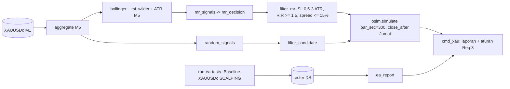

# Design — Riset scalping XAUUSD (H14)

Status: Done (2026-10-19)
Requirements: [requirements.md](requirements.md) (Approved 2026-10-19)

## 1. Overview

- **X1 (EA, tanpa kode baru):** backtest Strategy Tester `-Baseline -Period IS|OOS|REAL -Symbols XAUUSDc -SetInput InpTradingStyle=0` (0 = `SDB_STYLE_SCALPING`: bias M15, zona M5, trigger PA M1). Input lain dari preset XAUUSDc 1.37, termasuk BE 1,5R tanpa partial, zona lawan wajib, R:R ≥ 2, dan filter berita/sesi/spread. Laporan memakai fungsi baru `ea_report` (trade, /bulan, win, R, PF, DD, spread/R, lama, alasan tutup, tahap tolak).
- **X2 (lab):** fungsi baru di `tools/strategy_lab.py`:
  - indikator murni: `bollinger`, `rsi_wilder`;
  - keputusan murni `mr_decision`;
  - pengumpul sinyal `mr_signals` di atas bar M5 hasil agregasi M1;
  - exit: `osim.simulate` dengan TP = garis tengah BB lewat `opp_prox`, sehingga `build_stops` memakai TP itu dan menguji R:R ≥ 1,5.
- **Pembanding acak:** `random_signals` pada jam 07–17 UTC, arah acak (seed tetap), SL 1 ATR M5, TP tetap 1,5R.
- **Simulator:** satu parameter opsional baru `bar_sec` (default 900). Entry di bar M1 pertama sesudah bar sinyal tutup, yaitu t + 300 untuk M5. Default membuat perilaku spec 31/38 tidak berubah.

## 2. Arsitektur

## 3. Komponen dan antarmuka

| Fungsi | Murni | Keterangan | Req |
|---|---|---|---|
| `osim.simulate(..., bar_sec=900)` | ya | entry sesudah `c.time + bar_sec` | 2.3 |
| `bollinger(close, n=20, k=2.0) -> (mid, up, lo)` | ya | SMA dan deviasi standar populasi (seperti iBands MT5) atas n close terakhir; NaN sebelum n bar | 2.2 |
| `rsi_wilder(close, n=14) -> np.ndarray` | ya | RSI Wilder (seperti iRSI MT5), benih rata-rata sederhana n perubahan pertama | 2.2 |
| `mr_decision(close, up, lo, mid, rsi, hour) -> (dir, tp) \| None` | ya | SELL bila close > up dan RSI ≥ 75; BUY bila close < lo dan RSI ≤ 25; jam 07–17 UTC | 2.2, 2.5 |
| `mr_signals(d5, t_from, t_to) -> list[Signal]` | ya | bar M5 tertutup; jangkar = high (SELL) / low (BUY) bar sinyal; `tp` ikut di `Signal` | 2.1–2.3 |
| `filter_mr(c, rules) -> str \| None` | ya | `SL_RANGE` (di luar 0,5–3 ATR M5), `RR` (< 1,5 ke TP), `SPREAD` (> 15% R) | 2.4, EC-05 |
| `random_signals(d5, t_from, t_to, n, seed) -> list[Signal]` | ya | jam 07–17, arah acak, jangkar = close ∓ 0,9 ATR (SL 1 ATR dengan buffer 0,1) | 3.3 |
| `ea_report(db, ranges) -> dict` | tidak (DB `mode=ro`) | statistik trade EA + rata-rata spread/R (`signals.spread_points × point / R awal`) + tahap tolak | 1.2, 1.3 |
| CLI `xau --period IS [--period OOS ...] [--ea IS=A-B ...] [--db]` | — | baris X1 (bila `--ea`), X2, ACAK; tanda lolos IS / konfirmasi | 3.1–3.3 |

Perubahan pada struktur yang ada (aditif):
- `Signal` mendapat `tp: float | None = None` untuk TP garis tengah.
- `to_candidate(..., tp=None)` mengisi `opp_prox = tp`.
- Aturan exit X2: `ExitRules(sl_buffer_atr=0.1, min_rr=1.5, min_sl_atr=0.5, max_sl_atr=3.0, be_r=99, partial_r=99, …)` dengan `atr_mtf` = ATR(14) M5.

## 4. Data models

- Tidak ada perubahan DB atau EA.
- Konstanta di atas modul: `BB_N = 20`, `BB_K = 2.0`, `RSI_N = 14`, `RSI_HI = 75`, `RSI_LO = 25`, `MR_FROM_H = 7`, `MR_TO_H = 17`, `M5_SEC = 300`, ambang lolos Req 3.1 (`XAU_MIN_PER_MONTH = 20`, `XAU_MAX_DD = 25`).

## 5. Error handling

| Kondisi | Perilaku |
|---|---|
| CSV XAUUSDc tidak ada | exit 2 dengan pesan |
| Sesi EA tidak ditemukan (`--ea`) | exit 2 |
| Bar M5 kurang dari 20 (awal data) | sinyal dilewati sampai indikator terisi |
| Posisi masih terbuka di akhir data | tidak dihitung, jumlah dicatat |

## 6. Test case

| ID | Kasus | Harapan | Req |
|---|---|---|---|
| TS-150 | `simulate(bar_sec=300)`: entry di open bar M1 t + 300; default = perilaku lama (TS-145 dan uji kalibrasi tetap PASS) | sesuai | 2.3 |
| TS-151 | `bollinger` pada 20 close 1..20: mid 10,5, sd populasi 5,766 → up 22,03, lo −1,03; `rsi_wilder` pada deret naik terus → 100, deret selang-seling sama besar → 50 | angka tepat | 2.2 |
| TS-152 | `mr_decision`: close > up + RSI 76 jam 10 → SELL, tp = mid; RSI 74 → None; close < lo + RSI 24 → BUY; jam 18 → None | sesuai | 2.2, 2.5 |
| TS-153 | `filter_mr`: TP 1,4R → `RR`; SL 0,4 ATR → `SL_RANGE`; spread 16% R → `SPREAD`; R:R 1,5 tepat → lolos | sesuai | 2.4, EC-05 |
| TS-154 | Tanpa lookahead: `mr_signals` pada XAUUSDc Mar 2026 identik sebelum/sesudah data sesudah bar sinyal dibuang (skip bila CSV tidak ada) | identik | 2.1 |
| TS-155 | `random_signals`: seed sama → hasil sama; semua jam 07–17; jangkar 0,9 ATR dari close | sesuai | 3.3 |
| TS-156 | `ea_report` pada DB SQLite sintetis (2 trade, 1 tolak spread): trade, win, R, spread/R, tahap tolak | angka tepat | 1.2, 1.3 |
| RUN-01 | X1 `-Baseline -Period IS -Symbols XAUUSDc -SetInput InpTradingStyle=0` + `xau --ea` | Req 3.1 | 1, 3.1 |
| RUN-02 | `xau --period IS` (X2, ACAK) | Req 3.1, 3.3 | 2, 3.1, 3.3 |
| RUN-03 | Setup lolos IS: OOS + REAL (X1 di tester, X2 di lab) | Req 3.2 | 3.2 |

## 7. Traceability

| Req | Komponen | Uji |
|---|---|---|
| 1.1–1.3 | run tester, `ea_report` | TS-156, RUN-01 |
| 2.1 | agregasi M5, bar tertutup | TS-154 |
| 2.2 | `bollinger`, `rsi_wilder`, `mr_decision` | TS-151, TS-152 |
| 2.3 | `mr_signals`, `simulate(bar_sec)` | TS-150, TS-154 |
| 2.4 | `filter_mr` | TS-153 |
| 2.5 | jam, `run_sequential`, `friday_close` | TS-152, TS-146/147 |
| 2.6 | `ExitRules` X2 | TS-153 |
| 3.1–3.5 | `cmd_xau`, `random_signals` | TS-155, RUN-01..03 |

## 8. Keputusan yang perlu disetujui

1. **X1 lewat EA asli** (gaya SCALPING yang sudah ada), bukan port ke lab. Lebih lambat, tetapi tanpa risiko perbedaan port.
2. **TP garis tengah lewat `opp_prox`**, supaya `build_stops` yang terkalibrasi menghitung R:R dan pembulatan. Filter `RR` memakai R:R sebelum pembulatan agar tidak terulang bug TS-144b.
3. **Indikator seperti MT5** (iBands deviasi populasi, iRSI Wilder), agar bisa dipindah ke EA tanpa selisih.
4. **Pembanding acak memakai SL 1 ATR M5 dan TP 1,5R**, dengan jam yang sama dengan X2.
5. **Kode X2 di `strategy_lab.py`** (modul lab yang sama), bukan modul baru.
