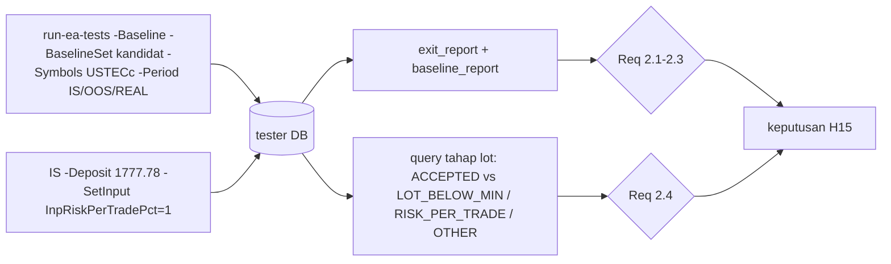

# Design — USTEC sebagai simbol ke-13 (H15)

Status: Done (2026-10-19)
Requirements: [requirements.md](requirements.md) (Approved 2026-10-19)

## 1. Overview

Tanpa kode baru. Semua bahan sudah ada sejak spec 35:
- preset `SDBot_DAY_USTECc.set` (magic 2026091914, spread maks 336 point = 3 × median);
- baseline kandidat `ea/tests/baseline/kandidat/BL-USTECc.ini`;
- runner `-BaselineSet kandidat`;
- kategori aset OTHER dengan batas posisi 1 (TC-RK-21).

Pengukuran memakai alat yang ada:
- `exit_report.py` untuk trade, R, PF, DD, alasan tutup, trade per bulan, dan lama posisi;
- `baseline_report.py` untuk tahap tolak teratas;
- satu query SQL read-only untuk syarat lot Req 2.4.

## 2. Alur



## 3. Run

| ID | Perintah | Req |
|---|---|---|
| RUN-01 | `run-ea-tests.ps1 -Baseline -BaselineSet kandidat -Symbols USTECc -Period IS -SkipBuild` | 1.1, 2.1 |
| RUN-02 | idem `-Period OOS` dan `-Period REAL` (hanya bila RUN-01 lolos) | 1.1, 2.2, 2.3 |
| RUN-03 | `-Period IS -Deposit 1777.78 -SetInput InpRiskPerTradePct=1` | 1.3, 1.4, 2.4 |

Query Req 2.4 (per sesi RUN-03):

```sql
SELECT SUM(status = 'ACCEPTED') AS opened,
       SUM(reject_stage IN ('LOT_BELOW_MIN', 'RISK_PER_TRADE', 'OTHER')) AS lot_rejected
FROM signals WHERE session_id = ?;
-- lolos bila opened / (opened + lot_rejected) >= 0,80
```

## 4. Data dan error handling

- Tidak ada perubahan DB, EA, atau preset repo.
- Real ticks USTECc lebih pendek dari REAL: runner mencetak ShortHistory, dan hasilnya dicatat apa adanya.
- Sesi tidak terbentuk (histori tester tidak ada, seperti ETH di spec 35): H15 tidak teruji, dicatat.

## 5. Test case

| ID | Kasus | Harapan | Req |
|---|---|---|---|
| RUN-01 | IS konfigurasi 1.37 | ≥ 10 trade, ≥ +0,10R, PF ≥ 1,20 | 2.1 |
| RUN-02 | OOS dan REAL | masing-masing total ≥ 0 dan DD ≤ 5R; gabungan ≥ +0,05R | 2.2, 2.3 |
| RUN-03 | IS saldo 1.777,78 risk 1% | ≥ 80% kandidat tahap lot terbuka | 1.4, 2.4 |

Tanpa uji unit atau skenario baru, karena tidak ada kode yang berubah.

## 6. Traceability

| Req | Run |
|---|---|
| 1.1, 1.2 | RUN-01, RUN-02 |
| 1.3, 1.4 | RUN-03 |
| 2.1 | RUN-01 |
| 2.2, 2.3 | RUN-02 |
| 2.4 | RUN-03 |
| 2.5, 2.6 | keputusan |

## 7. Keputusan yang perlu disetujui

1. **Tanpa kode baru**: memakai preset, baseline, dan runner spec 35.
2. **RUN-02 hanya bila RUN-01 lolos** (aturan Fase 5b: pilih dari IS, konfirmasi sekali).
3. **RUN-03 selalu dijalankan**, karena kelayakan lot di saldo kecil penting untuk live, lepas dari hasil IS.
